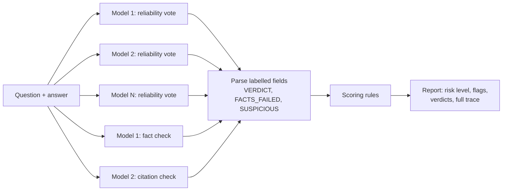

# MAVEN

[](LICENSE)
[](https://www.python.org/downloads/)

MAVEN (Multi-Agent Verification Engine) asks several large language models to review an answer written by another model and flags answers that probably contain made-up facts or sources. It is a prototype I built to learn how far a simple "second opinion" approach gets.

## Why

Language models sometimes state false things with confidence: invented studies, wrong dates, court cases that don't exist. The idea behind MAVEN is to check an answer before trusting it, by asking other models, independently, whether it holds up.

The project started as a multi-model *debate* for writing answers: three models took turns proposing an answer, criticising it and merging the views. In early, informal tests on a handful of simple questions the debate did worse than a single model, because the models kept second-guessing correct answers. So I switched to using several models as *reviewers* of an answer instead. The debate code is still in the git history at tag `v0.2.0`.

## Demo

```console
$ maven --models mock-a,mock-b --answer "Charlotte Bronte wrote it in 1847." "Who wrote Pride and Prejudice?"
Risk level:     MEDIUM
Verdicts:       QUESTIONABLE, QUESTIONABLE
Reliable votes: 0% of reviewer models
Flags:          none

Recommendation: not enough reviewers rated it RELIABLE; verify key claims.
```

This run uses the built-in mock models, so it needs no API key. Mock models don't return real verdicts, which is why the result is MEDIUM. It only shows the output format. With an API key set, leave out `--models` to use real models.

<!-- Screenshot or GIF of a run with real models goes here. -->

## How it works



1. **Reliability vote.** Every reviewer model gets the question and the answer and replies `VERDICT: RELIABLE`, `QUESTIONABLE` or `UNRELIABLE`.
2. **Fact check.** The first model lists claims that are wrong or can't be verified (`FACTS_FAILED:`).
3. **Citation check.** The second model lists sources that look invented (`SUSPICIOUS:`).
4. **Parsing.** Replies are plain text, so MAVEN reads the labelled fields with regular expressions. A reply without a verdict counts as QUESTIONABLE.
5. **Scoring.** Fixed rules turn the results into a risk level:

| Risk level | When |
|---|---|
| CRITICAL | 2 or more models vote UNRELIABLE, or 2 or more flags |
| HIGH | any flag: one UNRELIABLE vote, a failed fact check, a suspicious citation, or a failed API call |
| MEDIUM | fewer than 75% of the models vote RELIABLE |
| LOW | otherwise |

The report's `reliable_share` is the percentage of models that voted RELIABLE. It is a vote share, not a calibrated probability.

Checking one answer with N reviewer models costs N + 2 API calls. `HallucinationDetector` makes them one after another, with a 1-second pause between calls. `AsyncHallucinationDetector` sends them at the same time with `asyncio.gather` and uses a semaphore to cap how many calls are in flight. Temporary API errors such as rate limits are retried up to three times with exponential backoff (via `tenacity`). A missing API key stops the run immediately with a clear error.

| File | What it does |
|---|---|
| [`src/maven/hallucination_detector.py`](src/maven/hallucination_detector.py) | Prompts, reply parsing, scoring rules, report, sync detector |
| [`src/maven/async_hallucination_detector.py`](src/maven/async_hallucination_detector.py) | Same checks with concurrent calls |
| [`src/maven/models.py`](src/maven/models.py), [`async_models.py`](src/maven/async_models.py) | One adapter per provider (Together AI, OpenAI, Anthropic, Google) plus mock models for tests |
| [`src/maven/cli.py`](src/maven/cli.py) | The `maven` command |
| [`scripts/evaluate_truthfulqa.py`](scripts/evaluate_truthfulqa.py) | Evaluation on TruthfulQA (see below) |

## Tech stack

- Python 3.10+ with `asyncio`
- Provider SDKs: `openai` (also used for Together AI, whose API follows the OpenAI format), `anthropic` and `google-generativeai`
- `tenacity` for retries
- pytest and pytest-asyncio for tests; no test calls a real API
- ruff for linting and formatting, mypy for type checking, pre-commit
- GitHub Actions CI on Python 3.10 to 3.14, with dependencies pinned in `requirements-dev.lock` (generated with uv)

## Getting started

You need Python 3.10 or newer.

```bash
git clone https://github.com/rwondo/maven.git
cd maven
python -m venv .venv
source .venv/bin/activate      # Windows: .venv\Scripts\activate
pip install -e ".[dev]"
pytest
```

Try the command without any API key, using the mock models:

```bash
maven --models mock-a,mock-b --answer "Charlotte Bronte wrote it in 1847." "Who wrote Pride and Prejudice?"
```

To use real models, set the API key for your provider (see [`.env.example`](.env.example)). The default reviewers are three Together AI models:

```bash
export TOGETHER_API_KEY="your-key"       # PowerShell: $env:TOGETHER_API_KEY = "your-key"
maven --answer "Charlotte Bronte wrote it in 1847." "Who wrote Pride and Prejudice?"
maven --models together/llama-3.1-8b,gpt-4o --json --answer "..." "..."
```

Model names are routed by prefix: `together/<alias or full model path>`, `claude-...`, `gpt-...` and `gemini-...`. They are passed to the provider as they are, so use names from your provider's current model list. Exit codes: 0 for LOW or MEDIUM risk, 1 for errors, 2 for invalid arguments, 3 for HIGH or CRITICAL risk.

From Python:

```python
from maven import HallucinationDetector

detector = HallucinationDetector(
    models=["together/llama-3.1-8b", "together/qwen-2.5-7b", "together/mixtral-8x7b"]
)
report = detector.detect(
    query="Who wrote Pride and Prejudice?",
    answer="Charlotte Bronte wrote it in 1847.",
)
print(report.risk_level, report.verdicts, report.flags)
```

To install the exact dependency versions CI uses: `pip install -r requirements-dev.lock && pip install --no-deps -e .`

## Evaluation

**There are no validated results yet.**

[`scripts/evaluate_truthfulqa.py`](scripts/evaluate_truthfulqa.py) measures how well the detector separates correct from wrong answers:

- **Data.** [TruthfulQA](https://github.com/sylinrl/TruthfulQA) (Lin et al., 2021) gives each question a best correct answer and a best incorrect answer, written by the dataset authors. The script downloads the file from a fixed commit and samples n questions with a fixed seed.
- **Labels.** Both answers of every sampled question are checked, so the data is 50% correct and 50% wrong and every label is known in advance.
- **Metrics.** Catch rate (share of wrong answers flagged), false-alarm rate (share of correct answers flagged) and accuracy, each with a Wilson 95% confidence interval. They are reported for two thresholds (flag MEDIUM or worse, flag HIGH or worse) next to a baseline that flags everything.
- **Failures.** Answers where an API call failed are left out of the scores and counted separately. Every run writes its full per-answer results to `results/` as JSON.

```bash
export TOGETHER_API_KEY="your-key"
python scripts/evaluate_truthfulqa.py --n 100      # 200 answers, about 1,000 API calls with 3 models
```

| Method (n = 100 questions, 200 answers) | Catch rate | False-alarm rate | Accuracy |
|---|---|---|---|
| Flag MEDIUM or worse | not run yet | not run yet | not run yet |
| Flag HIGH or worse | not run yet | not run yet | not run yet |
| Baseline: flag everything | 100% | 100% | 50% |

Caveat: TruthfulQA's reference answers are short sentences written by people. Real model answers are longer and messier, so results on this data show whether the detector can separate right from wrong at all, not how it performs on real output.

### Withdrawn results

Earlier versions of this README reported an 85.3% hallucination detection rate and 82% accuracy on 100 TruthfulQA questions. Those numbers were wrong, and I have withdrawn them:

- A model's answer only counted as truthful if it contained one of TruthfulQA's reference answers word for word, so 95 of the 100 answers were labelled untruthful.
- On those labels the detector flagged 85% of the "untruthful" answers and 80% of the "truthful" ones, so it was not telling them apart. Flagging every answer would have scored higher (95% accuracy against 82%).
- The flagging threshold was picked after looking at the results, on the same 100 answers.

The README also had a table saying multi-agent debate lowered answer accuracy to 33–67%. That came from a handful of questions, can't be reproduced, and has been removed as well. The evaluation script above replaces both.

## Status and limitations

MAVEN is a prototype and has not been evaluated yet (see above).

- **No outside evidence.** The reviewers only read the question and the answer. There is no web search or document lookup, and models that share a blind spot will agree with each other.
- **Text parsing.** Model replies are parsed as text. A model that ignores the requested format counts as QUESTIONABLE.
- **Vote share, not probability.** `reliable_share` is the percentage of models that voted RELIABLE, not a calibrated probability.
- **Same prompts everywhere.** Every topic gets the same prompts; there are no domain-specific checks.
- **Cost and speed.** Each answer costs N + 2 API calls, and the sync detector pauses 1 second between calls.
- **Model names.** Providers retire models. The default Together AI models and aliases have not been checked against the live API.
- **Gemini SDK.** Google has ended support for the `google-generativeai` SDK used by the Gemini adapter (it warns about this on import). The adapter should move to `google-genai`.
- **PyPI.** `maven-ai` 1.0.1 on PyPI is an older version that still makes the withdrawn claims. Install from source to get this version.

## License

MIT, see [LICENSE](LICENSE). Author: Arber Ferra ([@rwondo](https://github.com/rwondo)).
